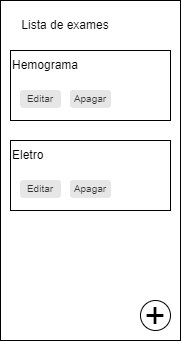

# Interface principal

Para a interface principal vamos ter uma lista no qual vai listar todos os exames realizados. 
Um botão de + para cadastrar um novo exame. Cada elemento/exame vai permitir eu clicar e abrir sua 
interface de visualização e edição no qual vai ser descrita em `interface de cadastro e edicao.md`.

Desenho da interface:

Exibir o titulo do exame no card.

No momento não vamos implementar as funcionalidades para os botões apagar, editar e o botão de 
cadastrar.

Referências para seguir da documentação

- [Documentação do Jetpack Compose](https://developer.android.com/develop/ui/compose/documentation): página principal sobre criação de telas com Compose.
- [Componentes Material no Compose](https://developer.android.com/develop/ui/compose/components): botões, campos de texto, cards, diálogos e outros componentes.
- [Layouts no Compose](https://developer.android.com/develop/ui/compose/layouts): como organizar elementos na tela com Column, Row, Box e layouts próprios.
- [Layouts com Views e XML](https://developer.android.com/develop/ui/views/layout/declaring-layout): modelo antigo, útil para manter projetos mais velhos.
- [Componentes do Material Design 3](https://m3.material.io/components): guia visual de como cada componente deve parecer e funcionar.

seguir arquitetura: `agent/arquitetura.md`